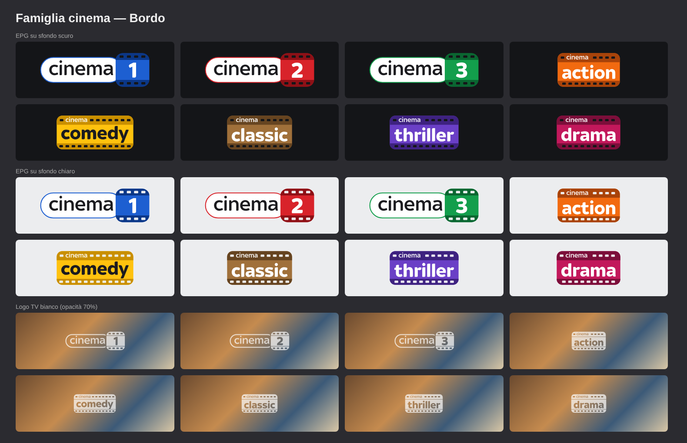

# tv-loghi

Loghi dei canali della TV privata (Tunarr / Plex).
Gli indirizzi qui sotto sono in HTTPS e vanno incollati in Tunarr come icona del canale,
così i loghi compaiono anche nella guida delle app Plex (Apple TV, iOS, Android, Web).

## Famiglia Cinema – loghi EPG (guida)

| Canale | Logo | Indirizzo da usare in Tunarr |
|---|---|---|
| Cinema Uno |  | `https://raw.githubusercontent.com/Vipp0/tv-loghi/main/cinema/epg/cinema-uno.png` |
| Cinema Due |  | `https://raw.githubusercontent.com/Vipp0/tv-loghi/main/cinema/epg/cinema-due.png` |
| Cinema Tre |  | `https://raw.githubusercontent.com/Vipp0/tv-loghi/main/cinema/epg/cinema-tre.png` |
| Cinema Action |  | `https://raw.githubusercontent.com/Vipp0/tv-loghi/main/cinema/epg/cinema-action.png` |
| Cinema Comedy |  | `https://raw.githubusercontent.com/Vipp0/tv-loghi/main/cinema/epg/cinema-comedy.png` |
| Cinema Classic |  | `https://raw.githubusercontent.com/Vipp0/tv-loghi/main/cinema/epg/cinema-classic.png` |
| Cinema Thriller |  | `https://raw.githubusercontent.com/Vipp0/tv-loghi/main/cinema/epg/cinema-thriller.png` |
| Cinema Drama |  | `https://raw.githubusercontent.com/Vipp0/tv-loghi/main/cinema/epg/cinema-drama.png` |

## Tematici mensili – loghi EPG

| Canale | Logo | Indirizzo da usare in Tunarr |
|---|---|---|
| Cinema HP |  | `https://raw.githubusercontent.com/Vipp0/tv-loghi/main/tematici/cinema-hp.png` |

## Loghi TV (bianchi, per il watermark in onda)

In `cinema/tv/`. Il watermark lo applica Tunarr al video, quindi qui servono solo come copia di riserva.

## Note

- Il repository deve restare **pubblico**, altrimenti le app Plex non scaricano i loghi.
- Quando si aggiorna un logo conviene cambiargli nome (es. `cinema-uno-v2.png`): le app Plex tengono in memoria le immagini vecchie.
- I sorgenti vettoriali (SVG) e gli script che generano i loghi sono in `D:\Download\2025` sul PC.
